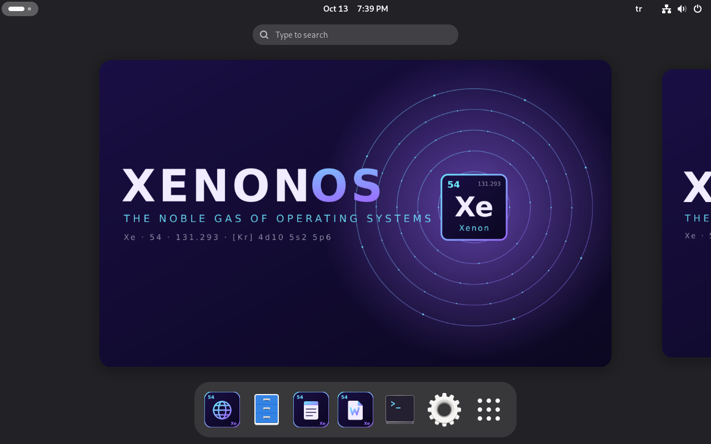
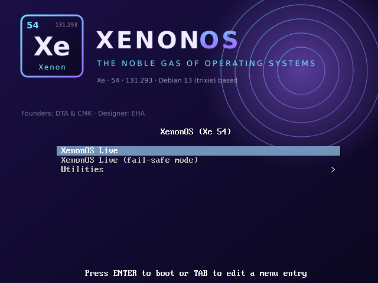
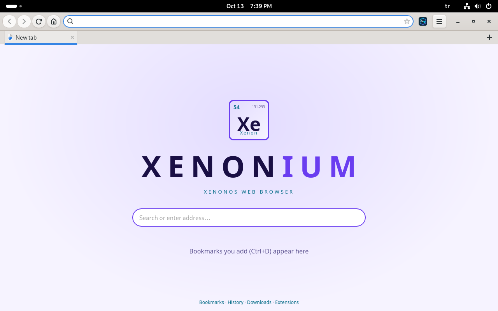
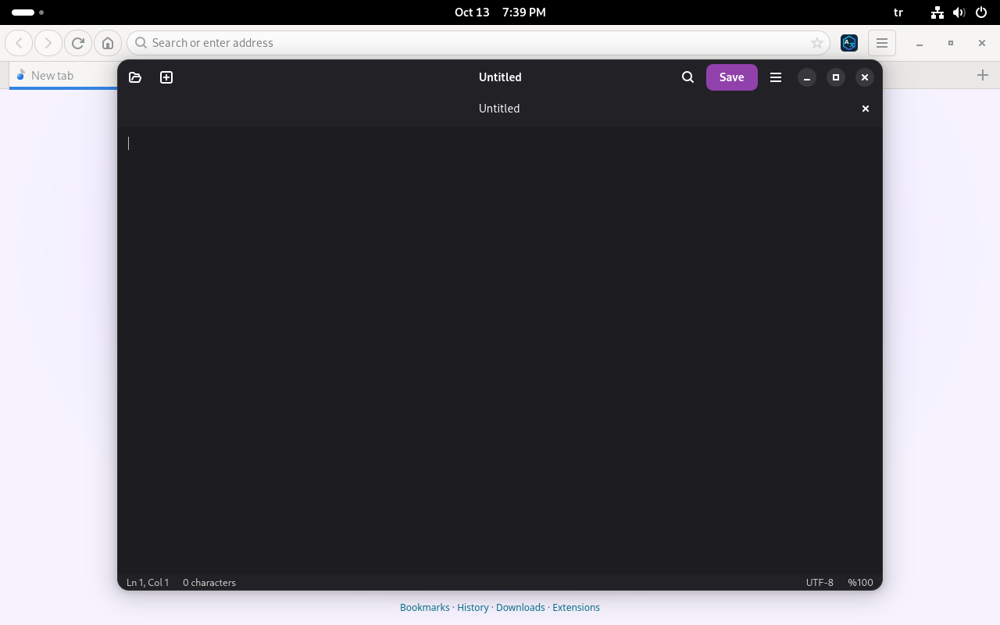
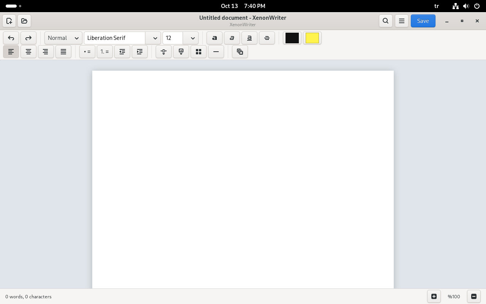

# XenonOS

## Download

**[xenonos-amd64.hybrid.iso (v1.0, Debian-based, 1.7 GB)](https://github.com/Camamaka/XenonOS/releases/download/v1.0/xenonos-amd64.hybrid.iso)** · [Release page](https://github.com/Camamaka/XenonOS/releases/tag/v1.0)

SHA256: `56D2F5D068FF6A0FEEE0E93D21A27C3C3565078D3353F4BF37473A10D0FC74ED`

Copy it to a USB drive with [Ventoy](https://www.ventoy.net) or write it with `dd`.

## Screenshots



| Boot menu | Xenonium browser |
|---|---|
|  |  |

| XenonPad | XenonWriter |
|---|---|
|  |  |

## About

XenonOS is a Linux distribution built on Debian 13 (trixie) and GNOME, shipping with its own applications.
The ISO is produced with Debian's `live-build` and uses Calamares as the installer. Contents:

| Folder | What's inside |
|---|---|
| `debian` | Scripts, `live-build` configuration and `.deb` packages for the Debian-based ISO (main release) |
| `apps/xenonium` | Xenonium web browser (GTK3 + WebKitGTK) and extensions |
| `apps/xenonium/extensions/xenontranslate` | XenonTranslate extension |
| `apps/xenonpad` | XenonPad text editor (GTK4 + libadwaita) |
| `apps/xenonwriter` | XenonWriter word processor (GTK3 + WebKit, HTML/PDF) |
| `xenonchat` | XenonChat messaging app (Electron + Vite) |
| `iso` | Legacy Ubuntu 26.04-based ISO scripts (`build-desktop.sh`) |
| `harness` | Helper scripts that test the apps visually on the Windows desktop through a WSL chroot |

## Building the ISO (Windows + WSL)
See [`debian/README.md`](debian/README.md) for details. In short, run as root in WSL (Debian/Ubuntu):

```bash
cd debian
sudo bash build-debs.sh   # builds the xenonium, xenonpad, xenonwriter and xenonos-defaults .deb packages
sudo bash build-iso.sh    # installs tools, downloads Debian packages, builds the ISO
```

- `build-iso.sh` downloads roughly 1.5–3 GB of packages and takes 20–60 minutes.
- Output: `debian/out/xenonos-*.iso` and `debian/out/SHA256SUMS`.
- Application sources are taken from the `apps/` folder.

### Legacy Ubuntu-based version
`iso/build-desktop.sh` installs XenonOS on top of the Ubuntu 26.04 desktop ISO (mount the source ISO in WSL with
`mount -t drvfs E: /mnt/e` and run the script as root; the output is `XenonOS-Desktop.iso`). This is no longer the main release.

## Xenonium shortcuts
Ctrl+T new tab · Ctrl+W close · Ctrl+Shift+T reopen closed tab · Ctrl+L address bar · Ctrl+F find · Ctrl+D bookmark ·
Ctrl+H history · Ctrl+J downloads · Ctrl+N new window · Ctrl+Shift+N private window · F12 developer tools ·
Alt+T (on a page) XenonTranslate panel.

## Writing your own Xenonium extension
`~/.local/share/xenonium/extensions/<name>/manifest.json` plus scripts. The API and an example are described at the top of
`extensions.py`; `extensions/xenontranslate/` is a sample extension. Extensions page: `xenon://extensions`.

## XenonTranslate
Translates selected text (via the 文 button that appears on selection), translates the whole page or restores the original,
and detects the page language. Translation service: `translate.googleapis.com` (keyless, unofficial endpoint) with MyMemory as a fallback.
If access to the service changes, update the `gtx()` function in `content.js`.

## Credits
- **Founders:** DTA and CMK
- **Design:** EHA
- **Maintainer:** [Camamaka](https://github.com/Camamaka)

## Contributing and license
Issues and pull requests are welcome, see [CONTRIBUTING.md](CONTRIBUTING.md). XenonOS is released under the [MIT License](LICENSE).
